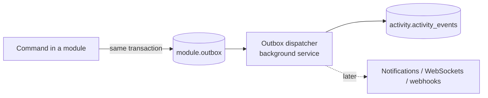

# Activity events — schema and first event types

Every state change produces an event. Events are the item history today and the input for notifications (v1.3), real-time and webhooks (v1.4) and the AI context layer later, so they are designed to be stable, self-describing and append-only.

## Flow



1. A module changes its own tables **and** inserts an outbox row in the same `SaveChanges` transaction. The state change and its event either both commit or neither does.
2. A background dispatcher reads unprocessed outbox rows in order, writes them to `activity.activity_events`, and marks them processed. It sets `app.org_id` from each row before writing (ADR-0002).
3. Delivery is **at least once**; consumers deduplicate on `event_id`.

History may lag a change by up to the dispatcher interval (target: under 1 second).

## Tables

`<module>.outbox` (one per module schema):

| Column | Type | Notes |
| --- | --- | --- |
| `id` | uuid | = `event_id` |
| `org_id` | uuid | RLS |
| `event_type` | text | |
| `envelope` | jsonb | the full event (below) |
| `created_at` | timestamptz | |
| `processed_at` | timestamptz | null until dispatched |

`activity.activity_events` (append-only: the app role may only `INSERT` and `SELECT`):

| Column | Type | Notes |
| --- | --- | --- |
| `event_id` | uuid | PK, UUIDv7 — orders events by time |
| `org_id` | uuid | RLS |
| `event_type` | text | e.g. `WorkItemStatusChanged` |
| `schema_version` | int | starts at 1 |
| `occurred_at` | timestamptz | when the change committed |
| `actor_type` | text | `user`, `agent`, `system` |
| `actor_id` | uuid | nullable for `system` |
| `entity_type` | text | `project`, `work_item`, `comment` |
| `entity_id` | uuid | |
| `entity_key` | text | human key when there is one (`TRK-42`) |
| `project_id` | uuid | nullable; lets history and feeds filter by project |
| `payload` | jsonb | event-specific, below |

Indexes: `(org_id, entity_id, event_id desc)` for item history, `(org_id, project_id, event_id desc)` for project feeds.

## Envelope

```json
{
  "eventId": "01927f3a-6c1e-7b4a-9d2e-3f5a8c7b1e20",
  "eventType": "WorkItemStatusChanged",
  "schemaVersion": 1,
  "occurredAt": "2026-10-06T09:41:12.345Z",
  "orgId": "01927f30-0000-7000-8000-000000000001",
  "actor": { "type": "user", "id": "01927f30-0000-7000-8000-0000000000aa" },
  "entity": { "type": "work_item", "id": "01927f3a-1111-7000-8000-000000000042", "key": "TRK-42" },
  "projectId": "01927f31-0000-7000-8000-0000000000b1",
  "payload": { "from": "in_progress", "to": "in_review" }
}
```

## Rules

- Names are **past tense**, `<Entity><Change>`: `WorkItemCreated`, not `CreateWorkItem`.
- Payloads carry **values, not just IDs** — enough to render history without reading other modules (for example the title at the time of the change).
- **Additive changes only** within a `schemaVersion`: new optional fields are fine. Renaming, removing or changing a field's meaning needs a new `schemaVersion`, and readers handle both.
- Field changes use `{ "field": { "from": …, "to": … } }`; unchanged fields are omitted.
- Never put secrets or password-related data in events.
- Board reordering (`rank` changes) is **not** an activity event — it would flood history.

## First event types

| Event | Emitted by | When | Payload |
| --- | --- | --- | --- |
| `ProjectCreated` | Projects (TRK-10) | A project is created | `{ "key": "TRK", "name": "Trekky" }` |
| `WorkItemCreated` | Work items (TRK-11) | An item is created | `{ "type": "story", "title": "Comments on items", "status": "todo", "parentId": "…" \| null }` |
| `WorkItemUpdated` | Work items (TRK-11) | Title, description, type or parent changes | `{ "changes": { "title": { "from": "Comments", "to": "Comments on items" } } }` — description changes record `{ "changed": true }`, not the full text |
| `WorkItemStatusChanged` | Work items (TRK-12) | Status changes | `{ "from": "in_progress", "to": "in_review" }` |
| `WorkItemAssigned` | Work items (TRK-15) | Assignee changes, including to nobody | `{ "from": "…" \| null, "to": "…" \| null }` |
| `CommentAdded` | Work items (TRK-14) | A comment is posted (entity = the work item) | `{ "commentId": "…", "excerpt": "first 200 characters" }` |

Organization and user events (`OrganizationCreated`, `MemberJoined`) are added with invites in v1.1. `CommentEdited` and `CommentDeleted` arrive with TRK-14 if editing ships there.

## History view (US-09)

The item detail's History tab reads `activity_events` for the item's `entity_id` (comment events use the item as their entity), newest first, 50 per page, and renders each event type with a fixed sentence, e.g. *Davit changed status In Progress → In Review*.
