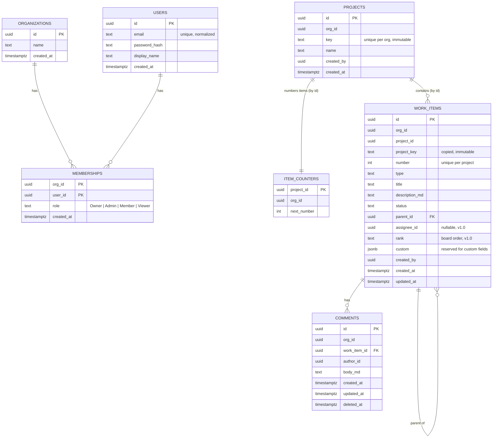

# Data model — v0.1 to v1.0

Postgres 17, one schema per module (ADR-0001), `org_id` + RLS on every tenant table (ADR-0002), UUIDv7 keys (ADR-0005). Diagrams render on GitHub.

## Rules

- **No foreign keys across module schemas.** A module stores another module's ID as a plain `uuid` and never joins across schemas; consistency is kept by the owning module's API and events. Foreign keys **within** a schema are normal.
- Every tenant table: `org_id uuid not null`, an index starting with `org_id`, RLS enabled and forced, `tenant_isolation` policy.
- Timestamps are `timestamptz`, set by the application from `TimeProvider` (UTC).
- Optimistic concurrency uses Postgres `xmin` (mapped as an EF Core concurrency token) and is exposed to clients as an ETag.
- Soft delete only where stated (`deleted_at`). The 30-day purge policy (open question) applies when GDPR delete arrives (v2).

## Modules and schemas

| Module | Schema | Tables | Arrives in |
| --- | --- | --- | --- |
| Identity | `identity` | users (+ ASP.NET Identity tables), organizations, memberships, OpenIddict tables | TRK-7 |
| Projects | `projects` | projects, outbox | TRK-10 |
| Work items | `work_items` | work_items, item_counters, comments, outbox | TRK-11, TRK-14 |
| Activity | `activity` | activity_events | TRK-10 |

## Diagram



`ACTIVITY_EVENTS` and the per-module `OUTBOX` tables are described in [activity-events.md](activity-events.md).

## Tables

### identity

| Table | Notes |
| --- | --- |
| `users` | ASP.NET Identity user, renamed from `AspNetUsers`; plus `display_name`. Unique `normalized_email`. Not tenant-scoped (a user can join several orgs later), so **no RLS**; the API never lists users outside the caller's memberships. Identity's `user_claims`, `user_logins`, `user_tokens` are renamed the same way; there are no Identity role tables (roles live on memberships). |
| `organizations` | `id`, `name` (1–80). RLS on `id` (`id = app.org_id`). |
| `memberships` | PK `(org_id, user_id)`, `role` (`owner`, `admin`, `member`, `viewer`, check constraint). RLS on `org_id`, plus `user_self_read` (below). v0.1: exactly one membership per user, created at sign-up as Owner. |
| `openiddict_applications`, `openiddict_authorizations`, `openiddict_scopes`, `openiddict_tokens` | Managed by OpenIddict, not tenant-scoped. |

**Finding a user's organization before a tenant is known.** Login and token refresh must read the user's membership before any `org_id` is known. `memberships` therefore has a second, read-only policy, `user_self_read`: `FOR SELECT USING (user_id = app.user_id)` (ADR-0007). The identity module sets `app.user_id` with `set_config(..., true)`, so it lasts for one transaction only. Writes still need `app.org_id`. Sign-up sets `app.org_id` the same transaction-local way to the new organization's id while it creates the organization and the Owner membership.

### projects

| Column | Type | Rules |
| --- | --- | --- |
| `id` | uuid | PK, UUIDv7 |
| `org_id` | uuid | not null, RLS |
| `key` | text | `^[A-Z][A-Z0-9]{1,9}$`, unique `(org_id, key)`, immutable |
| `name` | text | 1–80 |
| `created_by` | uuid | user id (identity module) |
| `created_at` | timestamptz | |

### work_items

| Column | Type | Rules |
| --- | --- | --- |
| `id` | uuid | PK, UUIDv7 |
| `org_id` | uuid | not null, RLS |
| `project_id` | uuid | projects module id, no FK |
| `project_key`, `number` | text, int | unique `(project_id, number)`; key = `project_key || '-' || number` |
| `type` | text | `epic`, `story`, `task`, `subtask`, `bug`, `tech_debt` (check constraint) |
| `title` | text | 1–200 |
| `description_md` | text | nullable, Markdown |
| `status` | text | `todo`, `in_progress`, `in_review`, `done` (check constraint) |
| `parent_id` | uuid | FK → `work_items.id`, same project; parent rules enforced in the domain (user stories US-06) |
| `assignee_id` | uuid | nullable user id (v1.0) |
| `rank` | text | lexicographic rank for board order within a status (v1.0) |
| `custom` | jsonb | not null default `'{}'`, reserved for custom fields (v1.5) |
| `created_by`, `created_at`, `updated_at` | | |

Indexes: `(org_id, project_id, updated_at desc, id)` for the list; `(org_id, project_id, status, rank)` for the board; `(parent_id)`.

`item_counters`: PK `project_id`, `org_id`, `next_number int not null default 1`. Created when the work-items module handles `ProjectCreated`. Creating an item runs, in one transaction:

```sql
UPDATE work_items.item_counters
   SET next_number = next_number + 1
 WHERE project_id = @projectId
RETURNING next_number - 1;   -- the new item's number
```

`comments` (v1.0): soft delete via `deleted_at`; edits set `updated_at`.

## Database roles

| Role | Used by | Rights |
| --- | --- | --- |
| `trekky_owner` | migrations | owns all schemas and tables |
| `trekky_app` | API at runtime | `SELECT, INSERT, UPDATE, DELETE` on module tables; `INSERT, SELECT` only on `activity.activity_events`; no `BYPASSRLS` |
