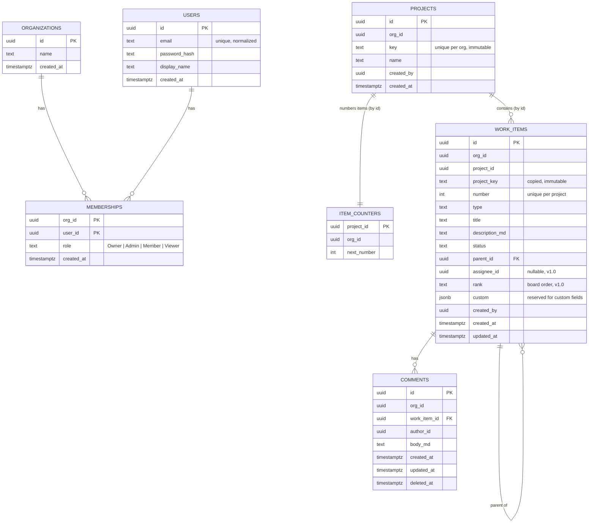

# Data model — v0.1 to v1.0

Postgres 17, one schema per module (ADR-0001), `org_id` + RLS on every tenant table (ADR-0002), UUIDv7 keys (ADR-0005). Diagrams render on GitHub.

## Rules

- **No foreign keys across module schemas.** A module stores another module's ID as a plain `uuid` and never joins across schemas; consistency is kept by the owning module's API and events. Foreign keys **within** a schema are normal.
- Every tenant table: `org_id uuid not null`, an index starting with `org_id`, RLS enabled and forced, `tenant_isolation` policy.
- Timestamps are `timestamptz`, set by the application from `TimeProvider` (UTC).
- Optimistic concurrency uses Postgres `xmin` (mapped as an EF Core concurrency token) and is exposed to clients as an ETag.
- Soft delete only where stated (`deleted_at`). The 30-day purge policy (open question) applies when GDPR delete arrives (v2).

## Modules and schemas

| Module | Schema | Tables | Arrives in |
| --- | --- | --- | --- |
| Identity | `identity` | users (+ ASP.NET Identity tables), organizations, memberships, OpenIddict tables | TRK-7 |
| Projects | `projects` | projects, outbox | TRK-10 |
| Work items | `work_items` | work_items, item_counters, work_item_revisions (proposed, ADR-0014), comments, outbox | TRK-11, TRK-18 |
| Activity | `activity` | activity_events | TRK-10 |

## Diagram



`ACTIVITY_EVENTS` and the per-module `OUTBOX` tables are described in [activity-events.md](activity-events.md).

## Tables

### identity

| Table | Notes |
| --- | --- |
| `users` | ASP.NET Identity user, renamed from `AspNetUsers`; plus `display_name`. Unique `normalized_email`. Not tenant-scoped (a user can join several orgs later), so **no RLS**; the API never lists users outside the caller's memberships. Identity's `user_claims`, `user_logins`, `user_tokens` are renamed the same way; there are no Identity role tables (roles live on memberships). |
| `organizations` | `id`, `name` (1–80). RLS on `id` (`id = app.org_id`). |
| `memberships` | PK `(org_id, user_id)`, `role` (`owner`, `admin`, `member`, `viewer`, check constraint). RLS on `org_id`, plus `user_self_read` (below). v0.1: exactly one membership per user, created at sign-up as Owner. |
| `openiddict_applications`, `openiddict_authorizations`, `openiddict_scopes`, `openiddict_tokens` | Managed by OpenIddict, not tenant-scoped. |

**Finding a user's organization before a tenant is known.** Login and token refresh must read the user's membership before any `org_id` is known. `memberships` therefore has a second, read-only policy, `user_self_read`: `FOR SELECT USING (user_id = app.user_id)` (ADR-0007). The identity module sets `app.user_id` with `set_config(..., true)`, so it lasts for one transaction only. Writes still need `app.org_id`. Sign-up sets `app.org_id` the same transaction-local way to the new organization's id while it creates the organization and the Owner membership.

### projects

| Column | Type | Rules |
| --- | --- | --- |
| `id` | uuid | PK, UUIDv7 |
| `org_id` | uuid | not null, RLS |
| `key` | text | `^[A-Z][A-Z0-9]{1,9}$`, unique `(org_id, key)`, immutable |
| `name` | text | 1–80 |
| `created_by` | uuid | user id (identity module) |
| `created_at` | timestamptz | |

### work_items

| Column | Type | Rules |
| --- | --- | --- |
| `id` | uuid | PK, UUIDv7 |
| `org_id` | uuid | not null, RLS |
| `project_id` | uuid | projects module id, no FK |
| `project_key`, `number` | text, int | unique `(project_id, number)` and `(org_id, project_key, number)` (lookup by key); key = `project_key || '-' || number` |
| `type` | text | `epic`, `story`, `task`, `subtask`, `bug`, `tech_debt` (check constraint) |
| `title` | text | 1–200 |
| `description_md` | text | nullable, Markdown |
| `status` | text | `todo`, `in_progress`, `in_review`, `done` (check constraint) |
| `parent_id` | uuid | FK → `work_items.id`, same project; parent rules enforced in the domain (user stories US-06) |
| `done_at` | timestamptz | when the item last moved to Done, cleared when it leaves; set exactly when status is `done` (check constraint); orders the board's Done column (TRK-15.1) |
| `assignee_id` | uuid | nullable user id (v1.0; column added by TRK-20) |
| `rank` | text collate "C" | board order within a status (TRK-17): a fractional index (`BoardRank`), compared byte by byte; a move writes only the moved card's rank. Unique per `(org_id, project_id, status)`; every rank or status write first locks the project's `item_counters` row, so two cards never get the same place. New items go on top of To Do, a status change on top of the new column. Existing items were ranked in the order the board showed them. Known limit: drops between the same two cards add about one character per six moves and nothing rebalances a column yet; ~16,000 such drops would pass Postgres's index entry size, so add rebalancing before that can happen |
| `custom` | jsonb | not null default `'{}'`, reserved for custom fields (v1.5) |
| `current_revision` | int | not null; the latest revision number (proposed, ADR-0014; existing items start at 1) |
| `created_by`, `created_at`, `updated_at` | | |

Indexes: `(org_id, project_id, updated_at desc, id desc)` for the list; `(org_id, project_id, status, rank)` unique, for the board (TRK-17); `(parent_id)`.

The work items module checks that a project exists, and reads its key, through the projects module's public `IProjectDirectory`. The projects list shows item counts through `IProjectItemCounts`, which projects defines and work items implements, so the two modules depend on each other in one direction only and never read each other's tables.

`item_counters`: PK `project_id`, `org_id`, `next_number int not null`. The project's first item creates the row (TRK-11 chose this over handling `ProjectCreated`, so an item can be created the moment its project exists, without waiting for the outbox). Creating an item runs, in one transaction with the insert:

```sql
INSERT INTO work_items.item_counters (project_id, org_id, next_number) VALUES (@projectId, @orgId, 2)
ON CONFLICT (project_id) DO UPDATE SET next_number = item_counters.next_number + 1
RETURNING next_number - 1;   -- the new item's number
```

The row lock serializes concurrent creates in a project; a rolled-back create returns its number.

`work_item_revisions` (proposed, ADR-0014; needs its own TRK) is the full history of every item. There is one row per revision: revision 1 on create, then one per change that records an activity event. Each row holds a JSONB snapshot of the item, including its description text. It is written in the same transaction as the change and its event. Revision numbers come from `work_items.current_revision`, which is incremented under the edit's row lock. Existing items get a baseline revision 1 (with `event_id` null) and `current_revision = 1`. The table is append-only: the migration revokes `UPDATE`, `DELETE` and `TRUNCATE` from `trekky_app`, so a purge runs as `trekky_owner`. It has no foreign key to `work_items`.

| Column | Type | Rules |
| --- | --- | --- |
| `work_item_id`, `revision` | uuid, int | PK; revisions count up from 1 per item |
| `org_id` | uuid | not null, RLS; index `(org_id, work_item_id, revision desc)` |
| `event_id` | uuid | the activity event for this change; null only for the backfilled baseline of an existing item |
| `actor_type`, `actor_id` | text, uuid | copied from the event's actor; `actor_id` null for `system` |
| `changed_at` | timestamptz | |
| `snapshot_version` | int | shape of `snapshot`, starts at 1 |
| `snapshot` | jsonb | every stored field except `rank` and `xmin` |

Events answer what changed. Revisions answer what the item was. A revision number is not the ETag (`xmin`).

`comments` (TRK-18): `id`, `org_id` (RLS), `work_item_id` FK, `author_id` (identity user, no FK across modules), `body_md` (1–20,000 characters, not only whitespace, no NUL: the validator checks Unicode whitespace; the check constraint checks the length and that `btrim` leaves something), `created_at`, `updated_at` (equal to `created_at` until edited; `edited` in the API is `updated_at > created_at`). Index `(work_item_id, created_at, id)` for the oldest-first keyset list. Soft delete via `deleted_at` comes with edit and delete in TRK-19.

## Database roles

| Role | Used by | Rights |
| --- | --- | --- |
| `trekky_owner` | migrations | owns all schemas and tables |
| `trekky_app` | API at runtime | `SELECT, INSERT, UPDATE, DELETE` on module tables; `INSERT, SELECT` only on `activity.activity_events` (and on `work_items.work_item_revisions` once it exists, ADR-0014); no `BYPASSRLS` |
